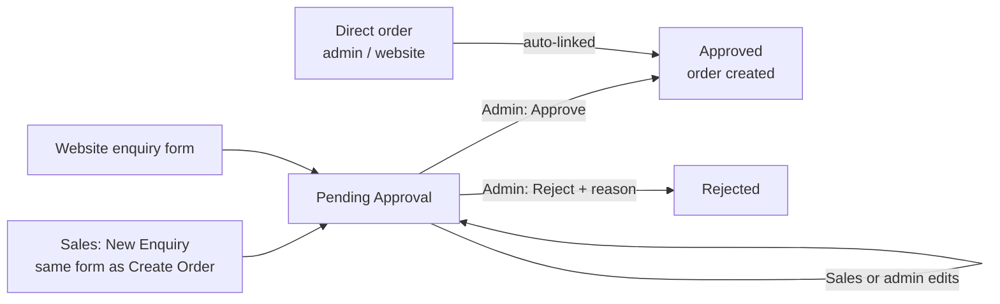

# Enquiry Process

This document describes how sales staff record orders as **enquiries**, and how an admin approves them into real orders.

- **Admins** create orders directly (Orders → New Order).
- **The website** creates orders directly.
- **Sales staff** create an **enquiry** using the **exact same form** as Create Order. It is stored separately and only becomes an order when an admin **approves** it.

---

## 1. Lifecycle

| Status | Value | Meaning | Can edit? | Can delete? |
|---|---|---|---|---|
| Pending Approval | `pending` | Waiting for an admin | Yes | Yes |
| Approved | `approved` | Order created and linked (`converted_order_id`) | No, edit the order instead | No |
| Rejected | `rejected` | Closed with a reason, no order created | No | Yes |

Defined in `app/Enums/EnquiryStatus.php` and `resources/js/admin/constants/enquiryStatuses.js`.

---

## 2. Creating an Enquiry (sales staff)

- Screen: **Enquiries → New Enquiry**.
- Component: `components/orders/OrderFormDialog.vue` with `mode="enquiry"`. This is the same component Create Order uses (`mode="order"`), so the two forms are identical:
  - **Customer:** full name\*, budget tier, email, phone\*, primary address\*, secondary address, additional notes
  - **Products:** catalog items or manual items (with image upload), quantity, price
  - **Summary:** discount, extra charges, grand total
- Endpoint: `POST /api/v1/enquiries` (`multipart/form-data`), with the same payload as `POST /api/v1/orders`: `customer[name|phone|email|address_1|address_2]`, `remarks`, `budget_tier`, `discount`, `extra_charges`, `items[i][product_id|product_name|quantity|unit_price|product_image]`. At least one item is required.

### Enquiry number
Format `EQ-<MON><YY><NNN>`, e.g. `EQ-NOV26001`. This is the same format and the same code as order numbers (`OD-NOV26001`): both use `App\Services\SequenceNumberGenerator::next()`. The 3-digit sequence restarts every month and counts soft-deleted records, so a number is never reused. Enquiries and orders have separate sequences.

Like order numbers, the UI hides the 2-digit year: `EQ-NOV26001` is shown as `EQ-NOV001`. This uses `formatDisplayNumber()` and `hideYearInText()` in `resources/js/admin/utils/displayNumber.js`. The Enquiry No filter accepts either form (`EQ-NOV001`, `NOV001` or `EQ-NOV26001`), the same as the order number filter.

Items go through the same `OrderService::prepareOrderItems()` as orders: catalog price lookup, manual items, and image upload to `public/uploads/orders`. Totals use `OrderService::calculateOrderTotals()`.
The grand total (`subtotal − discount + extra charges`) is stored in `total_amount`.

### Website enquiry form
`POST /api/v1/enquiries/public` (no login). Fields: `customer_name`\*, `customer_phone`\*, `customer_email`, `customer_address`, `message` (saved as notes), and an optional `product_id`/`product_name` + `quantity`. It creates a **pending** enquiry with no creator, shown as "Website" in the list. If the customer is logged in to the website, their account is stored in `user_id` and carried to the order on approval. The request body cannot set `user_id`. It has a honeypot field `website_check`.

---

## 3. Editing

- Pending enquiries can be edited from the list (pencil icon) or the info dialog. The same form opens, pre-filled.
- Endpoint: `PUT /api/v1/enquiries/{id}`. The frontend sends `POST` with `_method=PUT` because PHP does not parse multipart `PUT` bodies.
- Sending `items` replaces all items. Totals are recalculated.
- Approved and rejected enquiries are locked (422).

---

## 4. Approving and Rejecting (admin)

Requires the **Enquiry → Approve** permission, checked in the backend. `super-admin` always has it.

### Approve: `POST /api/v1/enquiries/{id}/approve`
In one transaction (`EnquiryService::approve`):
1. Checks that the status is `pending`, it is not already converted, and it has at least one item.
2. Creates the order via `OrderService::createOrder()`, exactly like Create Order: `orders`, `order_items`, `order_customer_details`, and the first tracking stage. Customer, addresses, budget tier, items (with images), discount and extra charges are copied. The order notes get "From enquiry EQ-…" appended.
3. Sets **Order taken by** on the Client Information stage to the sales person who created the enquiry.
4. Sets the enquiry to `approved` with `approved_by`, `approved_at` and `converted_order_id`.

### Reject: `POST /api/v1/enquiries/{id}/reject`
Body: `reason` (required). Sets `rejected`, `rejected_by`, `rejected_at` and `rejection_reason`. No order is created.

---

## 5. Who Sees What

| | Sales staff (no Approve permission) | Admin / super-admin |
|---|---|---|
| Enquiry list | Only enquiries **they created** | All enquiries |
| Create / edit pending | Yes (with Enquiry Create/Edit) | Yes |
| Approve / reject | No (403) | Yes |

Role permissions are managed in the admin panel's role settings. To set up a sales role: give it **Enquiry** List/View/Create/Edit and remove **Order → Create**, so its only way to place an order is through an enquiry.

---

## 6. Direct Orders

When an admin creates an order directly or the website places one, `OrderService::createOrder` calls `EnquiryService::createEnquiryFromOrder`. This stores an already-**approved** enquiry linked to the order, so every order has an enquiry record for reporting. The approve flow passes `skip_enquiry_creation` so this does not create a duplicate.

---

## 7. Data Model

| Table | Columns |
|---|---|
| `order_enquiries` | `enquiry_number`, `user_id` (website customer), `customer_name`, `customer_phone`, `customer_email`, `address_1`, `address_2`, `budget_tier`, `remarks`, `status` (ENUM `pending`/`approved`/`rejected`), `discount`, `extra_charges`, `total_amount` (grand total), `converted_order_id`, `approved_by/at`, `rejected_by/at`, `rejection_reason`, `added_by`, `modified_by`, timestamps, soft delete |
| `order_enquiry_items` | Same as order items: `product_id`, `product_name`, `product_image`, `quantity`, `unit_price`, `discount_amount`, `total_price` |

Who created, approved or rejected an enquiry, when, and why, is stored on `order_enquiries` itself. There is no separate history table.

### Migration

The whole redesign is one migration, `2026_11_05_120000_redesign_order_enquiries_for_approval.php`. It runs after the original `2026_10_29_14000x` enquiry migrations, and on the server you only need `php artisan migrate`. It:

1. Adds the order and approval columns (`address_1`, `address_2`, `remarks`, `discount`, `extra_charges`, `approved_by/at`, `rejected_by/at`, `rejection_reason`) and `discount_amount` on items.
2. Copies existing data across: `customer_address` → `address_1`, specifications and message → `remarks`, `lost_reason` → `rejection_reason`, `converted_at` → `approved_at`.
3. Maps old statuses: converted → `approved`, `not_approved` → `rejected`, everything else → `pending`. Then it makes `status` an ENUM.
4. Renames `quoted_amount` to `total_amount`.
5. Drops the old lead-tracking columns (source, occasion, branch, card type/size, specifications, delivery and follow-up dates, assigned staff, priority, attachments, message, lost reason, `converted_at`), the items `specifications` column, and the `order_enquiry_activities` table.
6. Renames enquiry numbers from `ENQ-` to `EQ-`.
7. Adds the **Enquiry → Approve** permission for Admin and super-admin.

Each step checks the current schema first. `migrate:rollback` restores the original column layout, but data in dropped columns can't be recovered, so back up the database before running it on the server.

---

## 8. API Summary

All routes are prefixed with `/api/v1`. Admin routes require `auth:sanctum` + `is_admin`.

| Method | Path | Who | Purpose |
|---|---|---|---|
| POST | `/enquiries/public` | Public | Website enquiry form |
| GET | `/enquiries` | Staff/Admin | List (own only for staff), `status_counts`, `can_approve` |
| POST | `/enquiries` | Staff/Admin | Create (same payload as orders) |
| GET | `/enquiries/{id}` | Staff/Admin | Details |
| PUT | `/enquiries/{id}` | Staff/Admin | Edit pending enquiry |
| DELETE | `/enquiries/{id}` | Staff/Admin | Soft delete (not when approved) |
| POST | `/enquiries/{id}/approve` | Approver | Create the order |
| POST | `/enquiries/{id}/reject` | Approver | Reject with `reason` |

List filters: `status` (`pending`, `approved`, `rejected`, `all`), `enquiry_number`, `customer` (name/phone/email/product), `total`, `date` (created date), `search`, `start_date`, `end_date`, `per_page`.

---

## 9. Key Files

| Layer | File |
|---|---|
| Routes | `routes/admin.php` |
| Controller | `app/Http/Controllers/Admin/EnquiryController.php` |
| Service | `app/Services/EnquiryService.php` (uses `OrderService` for items, totals and order creation) |
| Numbering | `app/Services/SequenceNumberGenerator.php` (shared by orders and enquiries) |
| Models | `app/Models/OrderEnquiry.php`, `OrderEnquiryItem.php` |
| Shared form | `resources/js/admin/components/orders/OrderFormDialog.vue` |
| Wrappers | `components/orders/OrderCreateDialog.vue` (order), `components/enquiries/EnquiryCreateDialog.vue` (enquiry create/edit) |
| List / details | `views/enquiries/EnquiryList.vue`, `components/enquiries/EnquiryInfoDialog.vue` |
